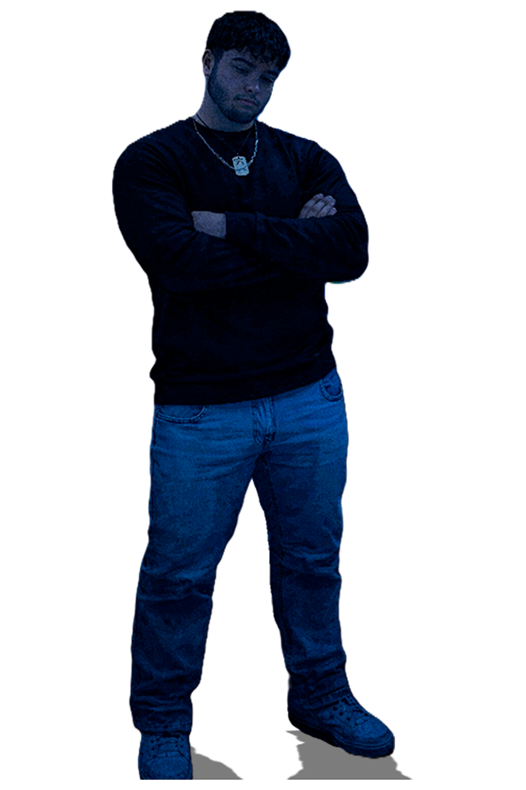
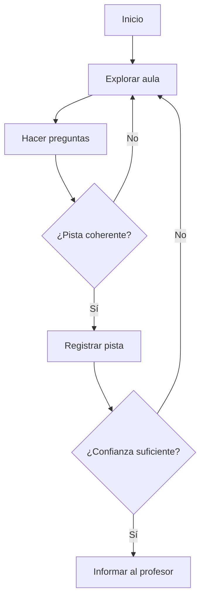
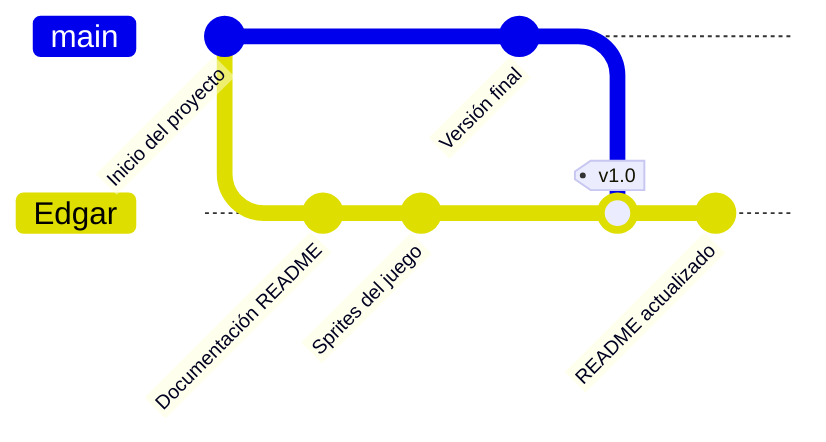
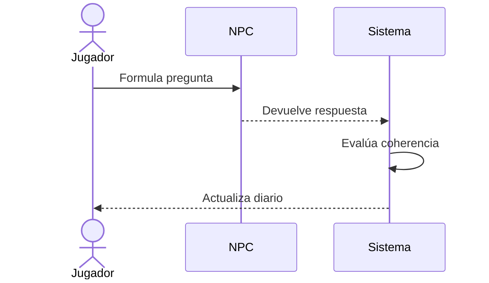
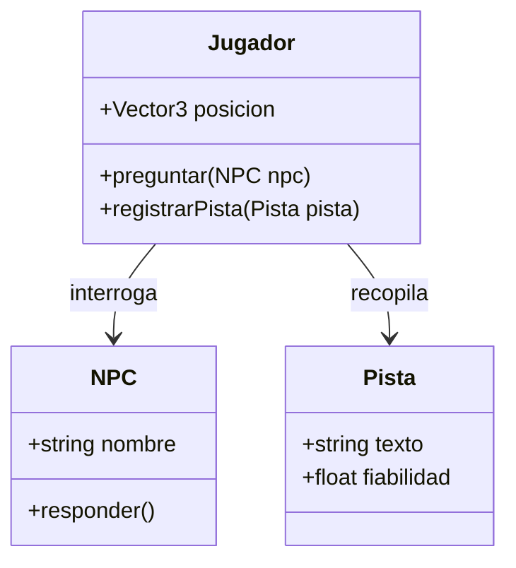
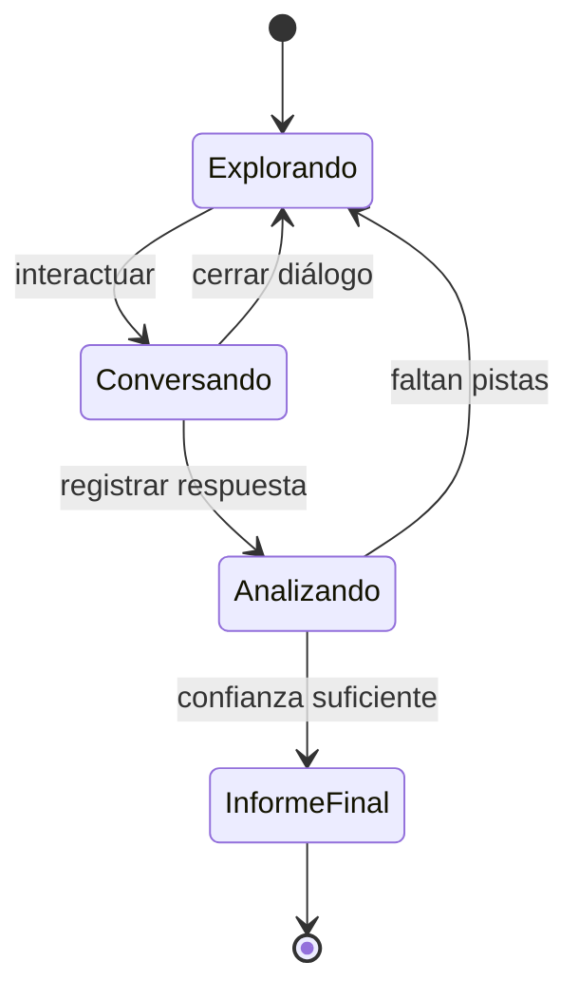

# Proyecto Intermodular: They Realized

[Ir al índice](#índice)

[](https://unity.com/) [](#estado-del-proyecto)

> Versión final del juego narrativo 3D de estética retro/low poly. El jugador reúne pistas mediante preguntas, identifica al alumno responsable del conflicto y comunica la situación al profesor.

La rama `Edgar` incorpora ahora la versión final jugable procedente de `main`, incluidos los diálogos, escenas, correcciones de bugs y contenido de los distintos días.

## Índice

- [Presentación](#presentación)
- [Objetivos del proyecto](#objetivos-del-proyecto)
- [Tecnologías y estructura](#tecnologías-y-estructura)
- [Diseño del juego](#diseño-del-juego)
- [Guía de instalación y uso](#guía-de-instalación-y-uso)
- [Evidencias visuales](#evidencias-visuales)
- [Datos y planificación](#datos-y-planificación)
- [Matemáticas del juego](#matemáticas-del-juego)
- [Diagramas](#diagramas)
- [Estado del proyecto](#estado-del-proyecto)
- [Contribución y licencia](#contribución-y-licencia)

<!-- README académico del proyecto intermodular. -->

## Presentación

[Volver al índice](#índice)

**They Realized** es una experiencia de investigación ambientada en un centro educativo. El jugador explora el escenario, conversa con personajes y compara respuestas antes de tomar una decisión.

La historia fomenta la *empatía*, la comunicación y la resolución responsable de conflictos.  
El objetivo no es acusar sin pruebas, sino construir una conclusión razonada.

---

## Objetivos del proyecto

[Volver al índice](#índice)

1. Crear una experiencia narrativa breve y accesible.
   1. Diseñar diálogos ramificados.
   2. Integrar pistas en el escenario.
   3. Mostrar una conclusión coherente.
2. Practicar el flujo de producción de Unity.
   1. Escenas y prefabs.
   2. Scripts en C#.
   3. Pruebas de interacción.

### Lista de tareas

- [x] Definir la premisa y el conflicto principal.
- [x] Crear la estructura inicial del proyecto.
- [x] Completar todos los diálogos.
- [x] Equilibrar la dificultad de las pistas.
- [x] Preparar una versión final para demostración.

> [!NOTE]
> Las decisiones deben basarse en varias pistas, no en una única respuesta aislada.

> [!WARNING]
> El contenido representa un conflicto escolar de forma responsable. No se debe utilizar para señalar a personas reales.

## Tecnologías y estructura

[Volver al índice](#índice)

| Tecnología | Uso | Referencia |
| :--- | :--- | :--- |
| **Unity** | Motor y escenas 3D | [Sitio oficial](https://unity.com/ "Web oficial de Unity") |
| **C#** | Lógica de gameplay | [Documentación](https://learn.microsoft.com/es-es/dotnet/csharp/ "Documentación de C#") |
| **ShaderLab/HLSL** | Materiales y efectos | [Unity Manual](https://docs.unity3d.com/Manual/Shaders.html "Manual de shaders") |

### Estructura principal

```text
.
├── Assets/             # Escenas, scripts, modelos y materiales
├── Packages/           # Dependencias de Unity
├── ProjectSettings/    # Configuración del proyecto
├── LiarGame/           # Solución y contenido adicional
├── LiarGame.slnx       # Solución para el editor
└── README.md           # Documentación
```

Consulta el [manifiesto de paquetes](Packages/manifest.json "Abrir manifest.json") y la carpeta de [recursos](Assets/ "Abrir Assets").

### Código C#

```csharp
public bool EsPistaSuficiente(int respuestasCorrectas, int totalPreguntas)
{
    const float umbral = 0.60f;
    return totalPreguntas > 0 &&
           (float)respuestasCorrectas / totalPreguntas >= umbral;
}
```

También se utiliza código en línea como `Debug.Log("Pista registrada")` durante las pruebas.

## Diseño del juego

[Volver al índice](#índice)

### Bucle de juego

El ciclo principal combina exploración y diálogo:

1. Observar el aula.
2. Hablar con un personaje.
3. Registrar una pista.
4. Comparar testimonios.
5. Informar al profesor.

<details>
<summary><strong>Decisiones de diseño</strong></summary>

La interfaz debe ser clara, con textos breves y señales visuales para que el jugador se concentre en la investigación.

</details>

> “Los juegos son la forma más elevada de investigación.”  
> — Albert Einstein, cita atribuida

> “La educación es el arma más poderosa que puedes usar para cambiar el mundo.”  
> — Nelson Mandela

### Personajes

| Rol | Responsabilidad narrativa | Indicador |
| --- | :---: | ---: |
| Jugador | Recoger y contrastar pistas | 🔎 |
| Compañeros | Aportar testimonios | 💬 |
| Profesor | Recibir el informe final | 🧑‍🏫 |
| Sospechoso | Reaccionar a las preguntas | ❓ |

## Guía de instalación y uso

[Volver al índice](#índice)

### Requisitos

- Unity Hub y una versión compatible.
- Sistema operativo capaz de ejecutar Unity.
- Git.

### Pasos

```bash
# Clonar el repositorio
git clone https://github.com/EdisJava/ProyectoIntermodular.git
cd ProyectoIntermodular
git switch Edgar
```

1. Abre Unity Hub.
2. Selecciona **Add** y elige la carpeta que contiene `Assets`, `Packages` y `ProjectSettings`.
3. Espera a que Unity importe los paquetes.
4. Ejecuta la escena inicial.

Revisa [UpgradeLog.htm](UpgradeLog.htm "Registro de actualización") y la [solución](LiarGame.slnx "Abrir solución LiarGame").

## Evidencias visuales

[Volver al índice](#índice)

### Logo de Unity


*Logotipo de Unity utilizado como referencia del motor del proyecto. Fuente: [Wikimedia Commons](https://commons.wikimedia.org/wiki/File:Unity_2021.svg "Fuente de la imagen").*

### Sprites del juego





Estos son sprites reales utilizados por los personajes del juego y muestran mejor el estilo visual **retro** de la versión final.

## Datos y planificación

[Volver al índice](#índice)

### Prioridades

| Tarea | Prioridad | Responsable |
| ---: | :---: | --- |
| Diálogos | Alta | Narrativa |
| Interacciones | Media | Programación |
| Materiales | Baja | Arte |

### Evaluación

| Criterio | Puntuación máxima | Resultado esperado |
| :--- | ---: | :--- |
| Narrativa | 10 | Historia comprensible |
| Jugabilidad | 10 | Controles claros |
| Presentación | 10 | Estética coherente |

### Versiones

| Versión | Fecha | Cambio |
| :--- | :---: | :--- |
| 0.1 | 2026 | Prototipo de exploración |
| 0.2 | 2026 | Primeros diálogos |
| 1.0 | 2026 | Versión final jugable integrada en `Edgar` |

## Matemáticas del juego

[Volver al índice](#índice)

**Las fórmulas de esta sección son inventadas: sirven para representar posibles mecánicas del juego, no resultados reales de una partida.**

La confianza se expresa en línea como $C = \frac{p}{n}$, donde $p$ son pistas coherentes y $n$ pistas analizadas.

La probabilidad de hallar una pista es:

$$P(\text{hallazgo}) = 1 - (1-q)^k$$

La distancia euclídea entre dos posiciones es:

$$d = \sqrt{(x_2-x_1)^2 + (y_2-y_1)^2 + (z_2-z_1)^2}$$

La intensidad de una señal periódica puede modelarse así:

$$I(t) = I_0 + A\sin(2\pi ft + \varphi)$$

El tiempo medio de una partida es:

$$\bar{t} = \frac{1}{m}\sum_{i=1}^{m} t_i$$

La experiencia acumulada puede seguir una progresión geométrica:

$$E_n = E_0r^n$$

## Diagramas

[Volver al índice](#índice)

### Flujo



### Historial de ramas Git



### Secuencia



### Clases



### Estados



## Estado del proyecto

[Volver al índice](#índice)

| Área | Estado | Próximo paso |
| :--- | :---: | :--- |
| Concepto | ✅ Completo | Mantener alcance |
| Escenas | ✅ Integradas | Revisar iluminación opcional |
| Diálogos | ✅ Integrados | Correcciones menores |
| Bugs principales | ✅ Corregidos | Validación final |
| Entrega | ✅ Disponible | Compartir build |

> [!TIP]
> Para probar una interacción, crea primero un caso pequeño: un personaje, una pregunta y una pista.

El proyecto está en su **versión final jugable**, integrada desde `main` en la rama `Edgar`. ~~La versión definitiva estaba pendiente~~; ahora el contenido principal y el vídeo de demostración están disponibles.

## Contribución y licencia

[Volver al índice](#índice)

- Crea una rama descriptiva: `feature/dialogos-aula`.
- Documenta cualquier cambio de jugabilidad.
- Prueba la escena antes de abrir una propuesta.
- Evita datos personales o contenido identificable.

Consulta la [página del repositorio](https://github.com/EdisJava/ProyectoIntermodular "Repositorio en GitHub") y el [manual de Markdown](https://docs.github.com/es/get-started/writing-on-github "Guía oficial").

### Licencia

Este repositorio se utiliza con fines académicos. No se ha definido todavía una licencia de distribución.

