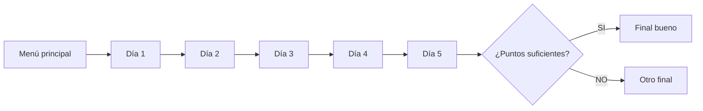
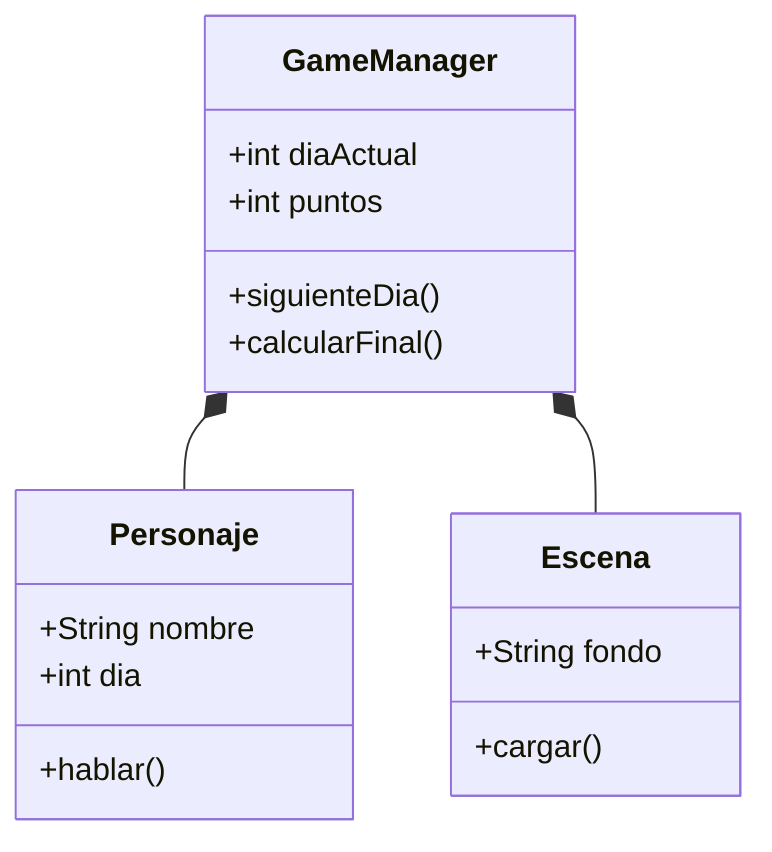
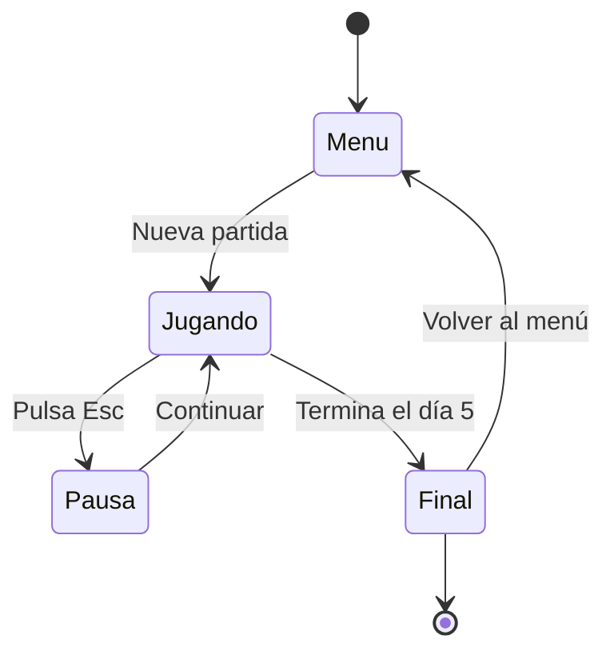
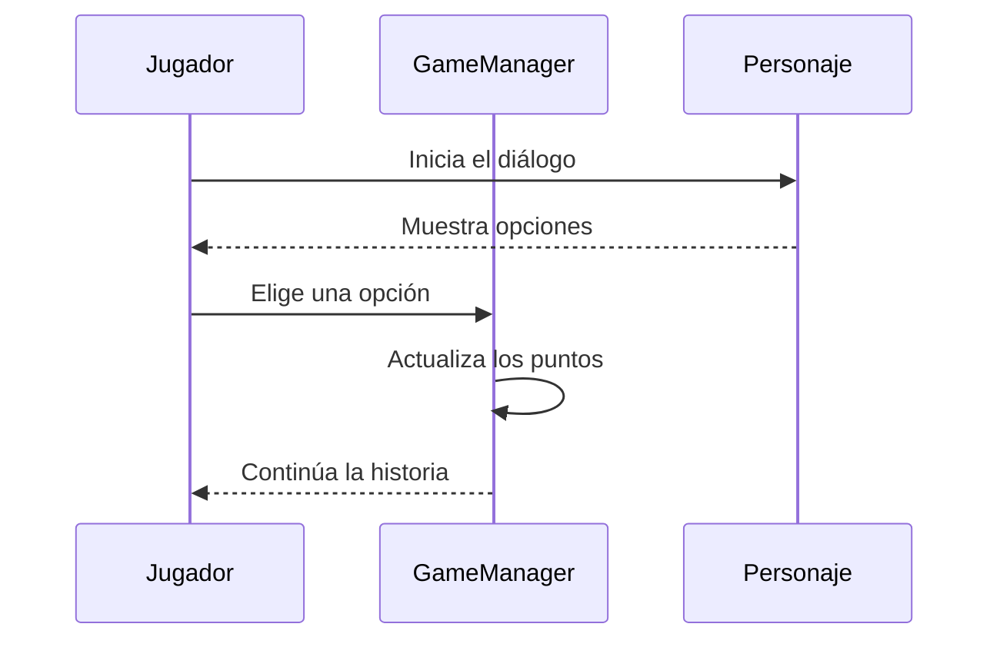
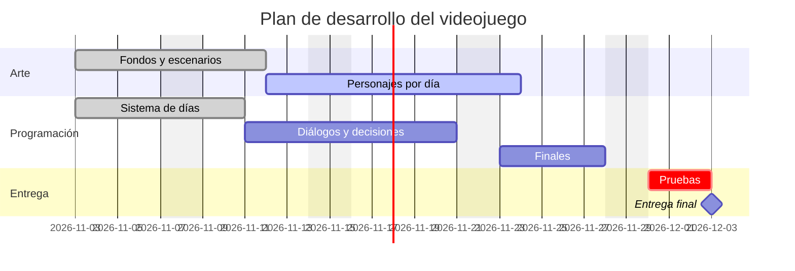
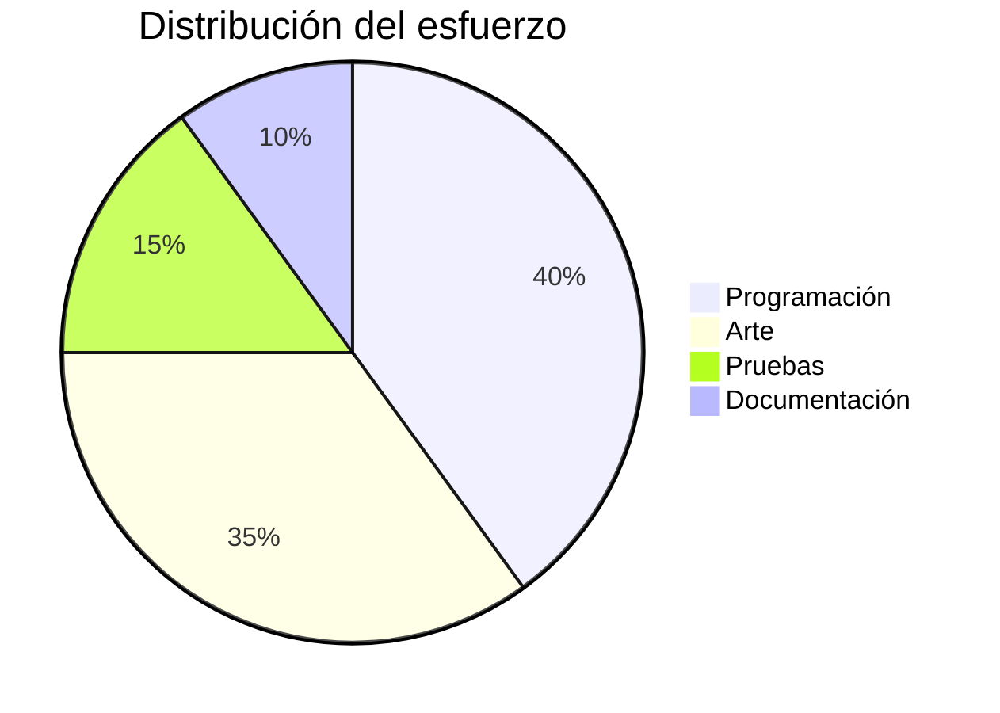

<a id="inicio"></a>

<div align="center">


</div>

# 🎮 ProyectoIntermodular

**ProyectoIntermodular** es un videojuego 2D desarrollado en *Unity* con C#, dividido en cinco días de historia.<br>
El jugador avanza por habitaciones y escenarios, conoce a los personajes de cada día y llega a uno de los finales posibles.<br>
***Este documento recoge su estructura, instalación y diseño técnico.***

Accede al [índice](#indice "Ir al índice") para navegar por el documento.

---

<a id="indice"></a>

# Índice

1. [Introducción](#introduccion "Ir a Introducción")
2. [Tecnologías](#tecnologias "Ir a Tecnologías")
3. [Estructura del proyecto](#estructura "Ir a Estructura")
4. [Instalación y uso](#instalacion "Ir a Instalación")
5. [Desarrollo del juego](#desarrollo "Ir a Desarrollo")
6. [Arquitectura del código](#arquitectura "Ir a Arquitectura")
7. [Matemáticas del juego](#matematicas "Ir a Matemáticas")
8. [Planificación y tareas](#planificacion "Ir a Planificación")
9. [Galería](#galeria "Ir a Galería")
10. [Referencias y citas](#referencias "Ir a Referencias")
11. [Autores](#autores "Ir a Autores")

---

<a id="introduccion"></a>

# 1. Introducción [↑](#indice "Volver al índice")

## 1.1 Descripción

La historia se reparte en cinco días.<br>
Cada día presenta nuevos personajes, escenarios y decisiones.<br>
Las decisiones del jugador determinan el final que se obtiene.

## 1.2 Objetivos

### 1.2.1 Objetivos técnicos

- Aplicar los conocimientos de programación en **C#**
- Organizar un proyecto de Unity con control de versiones
  - Una rama de trabajo por integrante (por ejemplo, `Pablo`)
  - Integración de cambios mediante *pull requests*
- Documentar el trabajo con Markdown

### 1.2.2 Objetivos de diseño

1. Crear una narrativa dividida en días
   1. Personajes propios de cada día
   2. Varios finales posibles
2. Diseñar escenarios y menús coherentes
3. Presentar el proyecto de forma clara

## 1.3 Formatos de texto

Texto en **negrita**, en *cursiva*, en ***negrita cursiva*** y ~~tachado~~.<br>
También pueden combinarse: **negrita con *cursiva* dentro**.

> [!NOTE]
> Este proyecto es de carácter educativo. Los recursos gráficos deben ser propios o de licencia libre.

---

<a id="tecnologias"></a>

# 2. Tecnologías [↑](#indice "Volver al índice")

| Tecnología | Uso en el proyecto | Versión |
| :--- | :--- | :--- |
| Unity | Motor del videojuego | 2022 LTS |
| C# | Lenguaje de los scripts | 9.0 |
| Git y GitHub | Control de versiones | 2.x |
| Visual Studio | Editor de código | 2022 |

Más información en la [web oficial de Unity](https://unity.com/ "Sitio oficial de Unity") y en el [manual de scripting](https://docs.unity3d.com/Manual/ "Manual de Unity").

---

<a id="estructura"></a>

# 3. Estructura del proyecto [↑](#indice "Volver al índice")

```text
ProyectoIntermodular/
└── Assets/
    ├── Scenes/
    ├── Scripts/
    └── Sprites/
        ├── escenas/
        │   └── final/
        └── personajes/
            ├── Dia1/ ... Dia5/
            └── FinalBueno/
```

Carpetas principales:

- [Assets/Scenes](Assets/Scenes "Escenas de Unity"): escenas del juego
- [Assets/Scripts](Assets/Scripts "Scripts en C#"): lógica del juego en C#
- [Assets/Sprites](Assets/Sprites "Recursos gráficos"): imágenes 2D
  - `escenas/`: fondos, habitaciones, menús y escenarios
    - `final/`: imágenes de la escena final
  - `personajes/`: personajes del juego
    - `Dia1/` a `Dia5/`: personajes organizados por día
    - `FinalBueno/`: imágenes de los finales
  - Los sprites sueltos están directamente en `Assets/Sprites/`

| Carpeta | Contenido | Archivos |
| :--- | :---: | ---: |
| `Sprites/escenas/` | Fondos y menús | Varios |
| `Sprites/escenas/final/` | Imágenes del final | Varios |
| `Sprites/personajes/Dia1-Dia5/` | Personajes por día | Varios |
| `Sprites/personajes/FinalBueno/` | Finales | Varios |

Consulta también este [README](README.md "Este mismo archivo") y la [guía de escritura de GitHub](https://docs.github.com/es/get-started/writing-on-github "Documentación de GitHub").

---

<a id="instalacion"></a>

# 4. Instalación y uso [↑](#indice "Volver al índice")

Necesitas Unity Hub y el editor instalado.<br>
Después clona el repositorio y cambia a la rama de trabajo.

```bash
git clone https://github.com/EdisJava/ProyectoIntermodular.git
cd ProyectoIntermodular
git checkout Pablo
```

Abre la carpeta desde Unity Hub y pulsa <kbd>Play</kbd> en el editor.<br>
Para guardar tus cambios usa `git commit -m "mensaje"`.

<details>
<summary>Ver comandos útiles de Git</summary>

```bash
git status
git add .
git push origin Pablo
```

</details>

> [!WARNING]
> No subas la carpeta `Library` de Unity al repositorio: es muy pesada y se regenera automáticamente.

---

<a id="desarrollo"></a>

# 5. Desarrollo del juego [↑](#indice "Volver al índice")

## 5.1 Estructura por días

| Día | Contenido | Personajes |
| :--- | :---: | ---: |
| Día 1 | Introducción | `Dia1/` |
| Día 2 | Desarrollo | `Dia2/` |
| Día 3 | Giro de la historia | `Dia3/` |
| Día 4 | Conflicto | `Dia4/` |
| Día 5 | Desenlace | `Dia5/` |

## 5.2 Controles

- <kbd>Clic</kbd>: avanzar el diálogo y elegir opciones
- <kbd>Esc</kbd>: abrir el menú de pausa

## 5.3 Ejemplo de gestión de días

```csharp
using UnityEngine;

public class GameManager : MonoBehaviour
{
    public int diaActual = 1;
    public int puntos = 0;

    public void SiguienteDia()
    {
        diaActual++;
        Debug.Log("Comienza el día " + diaActual);
    }
}
```

La variable `diaActual` indica qué carpeta de personajes se usa en cada momento.

> [!TIP]
> Mantén los nombres de los sprites coherentes dentro de cada carpeta para cargarlos fácilmente desde los scripts.

---

<a id="arquitectura"></a>

# 6. Arquitectura del código [↑](#indice "Volver al índice")

## 6.1 Flujo del juego



## 6.2 Clases principales



## 6.3 Estados del juego



## 6.4 Interacción con un personaje



---

<a id="matematicas"></a>

# 7. Matemáticas del juego [↑](#indice "Volver al índice")

## 7.1 Progreso de la partida

El porcentaje completado tras $d$ días jugados de un total de 5 es $p = \frac{d}{5} \cdot 100$. Por ejemplo, con $d = 3$ el progreso es del 60 %.

## 7.2 Puntuación total

Si $p_i$ son los puntos obtenidos cada día:

$$P = \sum_{i=1}^{5} p_i$$

## 7.3 Media y desviación

La media diaria de puntos es:

$$\bar{x} = \frac{1}{5}\sum_{i=1}^{5} p_i$$

y su desviación típica:

$$\sigma=\sqrt{\frac{1}{n}{\sum_{i=1}^{n}}{(x_{i}-\mu)^{2}}}$$

## 7.4 Selección del final

El final depende de un umbral $u$ de puntos:

$$
final = \begin{cases}
    \text{bueno} & \text{si }P \geq u \\
    \text{alternativo} & \text{si }P < u
    \end{cases}
$$

## 7.5 Probabilidad de una opción

Si un diálogo ofrece $n$ opciones igual de probables, la probabilidad de una concreta es:

$$P(A) = \frac{\text{casos favorables}}{\text{casos posibles}} = \frac{1}{n}$$

---

<a id="planificacion"></a>

# 8. Planificación y tareas [↑](#indice "Volver al índice")

## 8.1 Lista de tareas

- [x] Crear el proyecto en Unity
- [x] Crear la rama `Pablo`
- [x] Organizar los sprites por carpetas
- [ ] Terminar los personajes del día 5
- [ ] Implementar los finales
- [ ] Entregar el proyecto

## 8.2 Diagrama de Gantt



## 8.3 Reparto del esfuerzo



> [!IMPORTANT]
> La entrega final debe incluir el código, los sprites y este README actualizado.

---

<a id="galeria"></a>

# 9. Galería [↑](#indice "Volver al índice")

Imágenes del proyecto:


Imágenes de Internet:


---

<a id="referencias"></a>

# 10. Referencias y citas [↑](#indice "Volver al índice")

> *"Un juego retrasado es bueno eventualmente, pero un juego precipitado es malo para siempre."*
>
> — Shigeru Miyamoto (atribuida)

> *"La mejor manera de predecir el futuro es inventarlo."*
>
> — Alan Kay

Recursos consultados:

- [Unity Learn](https://learn.unity.com/ "Cursos oficiales de Unity")
- [Documentación de C#](https://learn.microsoft.com/es-es/dotnet/csharp/ "Documentación de C#")
- [Guía de Mermaid](https://mermaid.js.org/ "Documentación de Mermaid")

---

<a id="autores"></a>

# 11. Autores [↑](#indice "Volver al índice")

| Autor | Rol | Rama |
| :--- | :---: | ---: |
| Pablo | Desarrollo | `Pablo` |
| Equipo | Diseño y pruebas | `main` |

✏️ <strong>Escrito por el equipo de ProyectoIntermodular</strong>

© 2026 ProyectoIntermodular

[Volver al inicio](#inicio "Ir al principio del documento")
